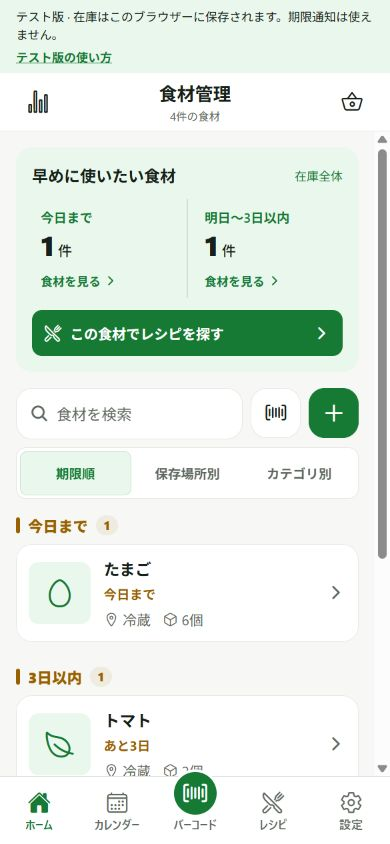
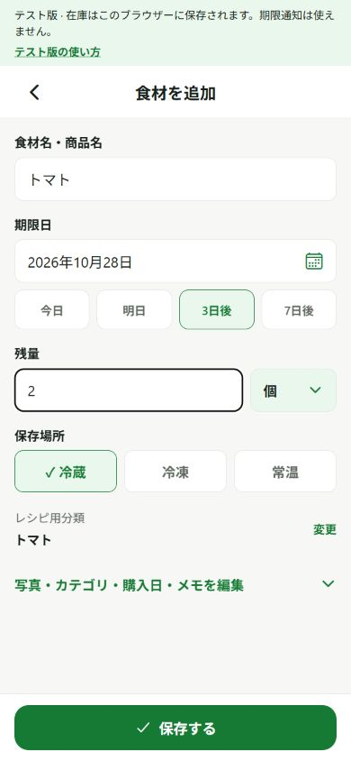
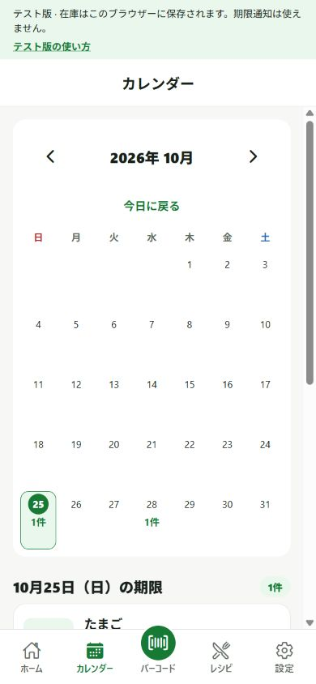

# たべどき！！

**冷蔵庫の「何がある？」「いつまで？」をまとめて、食べどきを逃さない。**

食材の期限と残量を管理し、手持ちの食材からのレシピ選び、不足材料の買い物までつなげるアプリです。iPhone版のリリースに向けて開発しています。

[公式サイト](https://tabedoki-official.pages.dev/) · [画面イメージ](#画面イメージ) · [主な機能](#主な機能) · [はじめる](#はじめる) · [開発ガイド](docs/DEVELOPMENT.md)

> **公開状況：** 公式サイトは公開済みです。iPhoneアプリは公開準備中で、App Storeでの一般配信はまだ行っていません。Android・Webの設定は開発・動作確認用として保持しています。

## 作った背景

冷蔵庫の奥にある食材を忘れたり、在庫を思い出せず同じものを買ったりすると、食材を使い切りにくくなります。

「登録する → 期限と在庫を見る → 料理に使う → 足りないものを買う」をつなげ、食材管理の手間と食品ロスを減らすことを目指しています。

## 画面イメージ

<p>
  
  
  
</p>

左からホーム・食材登録・カレンダー。開発中のWeb版をスマートフォン幅で撮影した実画面です。食材・日付・数量は撮影用サンプルで、iPhone版のスクリーンショットではありません。

## 主な機能

| 機能 | できること |
| --- | --- |
| 食材・在庫管理 | 賞味期限・消費期限、残量、写真、メモを登録・編集。冷蔵・冷凍・常温で分類 |
| 検索・期限の確認 | 名前の検索、期限順の並び替え、絞り込み、カレンダーでの確認・期限変更 |
| 登録の入力補助 | バーコード検索、自動補完、前回の登録内容を使った再登録 |
| レシピ | 手持ちの食材から内蔵レシピを探し、人数に合わせた分量と不足量を確認。自作レシピも登録可能 |
| 買い物リスト | 不足材料を分量メモ付きで追加し、購入後の食材登録へつなげる |
| 期限通知・統計 | 期限前のローカル通知、使い切り・廃棄の記録と集計 |
| バックアップ・削除 | 食材・レシピ・設定などの書き出しと復元。商品候補や復元前の退避を含む端末データの一括削除 |

[内蔵レシピは136件](docs/recipe-catalog.md)です。外部AIへその場で生成を依頼する方式ではなく、用意したレシピと在庫を照合します。料理画像には、このアプリ用に制作したAI生成イメージを使用し、[制作記録](assets/recipes/generated/manifest.json)を残しています。

基本操作は [使い方ガイド](docs/USAGE.md) と、アプリ内の「設定」→「使い方」で確認できます。「お問い合わせ」も設定画面から開けます。

## 技術構成

| 用途 | 技術・構成 |
| --- | --- |
| アプリ | Expo SDK 58 / React Native 0.88 / React 19.3 / TypeScript |
| 画面遷移・操作 | React Navigation / React Native Gesture Handler / Reanimated |
| 状態管理・端末保存 | React Context / AsyncStorage / Expo FileSystem |
| カメラ・写真・通知 | Expo Camera / ImagePicker / ImageManipulator / Notifications |
| 商品名検索 | Yahoo!ショッピング・Open Food Factsとの連携。Yahoo検索APIはCloudflare Workersに配置 |
| 共有商品API | Node.js 24系 / 組み込みの `node:sqlite`。アプリとは独立したAPIとして実装 |
| 検証・CI | `node:test` / TypeScriptの型チェック / GitHub Actions |

依存関係の正確なバージョンは [package.json](package.json) と [package-lock.json](package-lock.json) を参照してください。

## 実装で工夫したこと

### 読み込み失敗で保存データを上書きしない

保存データを検証してから画面の状態へ反映し、読み込めない場合は初期データで上書きせず復旧画面へ進みます。バックアップ復元では新しい世代の保存と読み戻しを確認した後、参照先を切り替えます。削除の途中状態も記録し、再起動後に再試行できます。

[保存処理](src/services/storage.ts) · [状態管理](src/context/AppDataContext.tsx) · [データ保護と復旧の設計](docs/data-protection.md)

### 商品検索に失敗しても登録を続けられる

端末に保存した商品候補から順に検索し、共有API・外部検索の障害時にも次の検索先へ進みます。商品が見つからない場合は手入力できます。YahooのClient IDは検索サーバーだけに設定し、アプリには含めません。

[商品検索の処理](src/services/productLookupService.ts) · [Yahoo商品名検索の構成](docs/yahoo-name-search.md)

### 通知の上限を考慮して予約を照合する

食材と通知設定から予定を作り、日時が早い60件までを予約します。端末にある予約と照合し、アプリが前面へ戻ったときにも再同期します。上限で絞った予定は不一致エラーとして扱いません。

[通知サービス](src/services/notificationService.ts) · [通知とバックアップの確認事項](docs/phase3-notifications-backup.md)

## はじめる

### 1. 開発環境を準備する

- **Node.js 24.19以降の24系**とnpm（[.nvmrc](.nvmrc) も参照）
- **Git**
- 実機で試す場合は、**Expo SDK 58に対応したExpo Go**

以下はWindowsのPowerShell用です。macOS・Linuxでは `npm.cmd` / `npx.cmd` の `.cmd` を外してください。

### 2. 取得・インストールする

```powershell
git clone https://github.com/arukuArupaka/Torikawa.git
cd Torikawa
npm.cmd ci
```

すでに取得済みなら、そのフォルダーで `npm.cmd ci` を実行します。

### 3. 起動する

**スマートフォンで試す**

```powershell
npm.cmd start
```

PC・スマートフォンを同じWi-Fiへ接続し、iPhoneは標準カメラ、AndroidはExpo GoからQRコードを読み取ります。Expo Goへのログインや外部接続が必要な場合は、[開発ガイド](docs/DEVELOPMENT.md)を参照してください。

**ブラウザーで試す**

```powershell
npm.cmd run web
```

初回の在庫と買い物リストは空で、期限通知はOFFです。サンプル在庫・サンプル商品を使う場合だけ、`.env` の `EXPO_PUBLIC_DEMO_DATA=true` を設定して再起動してください。既存のレシピに未収録の内蔵レシピを追加する手順は [レシピ一覧と追加方法](docs/recipe-catalog.md) にまとめています。

> 自動入力された期限・数量・保存場所は目安です。商品の表示や実際の残量を確認してください。Web版では期限通知を利用できません。カメラ・通知・写真付きバックアップは実機での確認も必要です。

友達のiPhoneで試してもらう場合は、[Webテスト版の準備・配布](docs/web-friend-testing.md) または [TestFlightの準備](docs/ios-release.md) を参照してください。Webテスト版はApple開発者登録なしで配布できます。

## 商品検索の設定（任意）

Yahoo!ショッピング検索や共有商品DBを利用する場合は、`.env` または `.env.local` に接続設定を用意します。設定しなくても食材の手入力・在庫管理は使えます。バーコード番号を入力して検索することもできます。

| 環境変数 | 用途 |
| --- | --- |
| `YAHOO_SHOPPING_APP_ID` | Yahoo検索APIのサーバーだけで使うClient ID。アプリには含めない |
| `EXPO_PUBLIC_YAHOO_LOOKUP_URL` | アプリから呼ぶ商品名検索APIのURL |
| `EXPO_PUBLIC_SHARED_PRODUCTS_URL` | 共有商品APIのURL |

設定例は [.env.example](.env.example)、詳しい手順は [環境変数の設定](docs/DEVELOPMENT.md#環境変数の設定) を参照してください。既存ファイルを上書きせず、必要な項目を追加・変更してExpoを再起動します。`EXPO_PUBLIC_` の値はアプリに含まれるため、秘密鍵やDBの認証情報を設定しません。

Yahoo検索はサーバー経由で商品名を取得し、Yahooの商品画像は使いません。食材アイコンまたは自分の写真を表示します。検索APIは常設していますが、商品名の保存・再利用などの利用条件は引き続き確認が必要です。[接続手順](docs/yahoo-name-search.md)・[利用条件の確認記録](docs/yahoo-usage-review.md)を参照してください。

## 商品情報の共有

**共有商品DBは実装済み・ローカル確認済みで、初回公開用のiPhone設定では未接続です。** 共有APIを設定した環境では、外部検索でも見つからなかった商品の手入力情報を、利用者の同意と管理者の承認を経て共有できます。投稿のチェックは初期状態でOFFで、共有情報の通報・手入力への切り替えもできます。

| 共有する情報 | 共有しない情報 |
| --- | --- |
| バーコード・商品名・レシピ用分類・カテゴリ | 個人の在庫・数量・期限・購入日・保存場所・メモ・写真・タグ・利用者ID |

**個人の冷蔵庫の中身を共有する機能ではありません。** 個人の食材や設定は端末内に保存します。APIの起動・公開設定・審査の操作は [共有商品DBの手順](server/README.md) を参照してください。

## 開発・検証

```powershell
npm.cmd test
npm.cmd run typecheck
```

保存・復元・削除、通知、商品検索、レシピ・在庫の計算、APIなどを [tests/](tests/) で検証しています。mainへのpushとPRでは、[CI](.github/workflows/ci.yml) が [.nvmrc](.nvmrc) のNode 24系で `npm ci` → テスト → 型チェックを実行します。端末の権限・カメラ・通知などは、自動テストに加えて実機で確認します。

開発時は [Expo SDK 58の公式ドキュメント](https://docs.expo.dev/versions/v58.0.0/) を参照してください。依存の追加は `npx.cmd expo install パッケージ名` を使います。[SDK 58への更新記録](docs/sdk58-upgrade-2026-10-26.md) に、移行内容・検証結果・実機確認項目をまとめています。

## ドキュメント

| 目的 | 読むページ |
| --- | --- |
| アプリの操作を知る | [使い方ガイド](docs/USAGE.md)・[期限通知](docs/USAGE.md#期限通知) |
| 環境構築・ファイル構成・不具合の対処を確認する | [開発ガイド](docs/DEVELOPMENT.md) |
| 保存・復元の設計を確認する | [データ保護と復旧](docs/data-protection.md) |
| 共有APIを起動・管理する | [共有商品DB](server/README.md) |
| iPhoneの公開準備を確認する | [公開準備と実機確認](docs/publication-readiness.md)・[iPhone版の公開手順](docs/ios-release.md) |
| 公式サイトを起動・更新する | [公式サイトの作成と確認](docs/official-site.md) |
| ポリシー・問い合わせ先を確認する | [正式プライバシーポリシー](https://tabedoki-official.pages.dev/privacy.html)・[お問い合わせ](https://tabedoki-official.pages.dev/support.html) |

<details>
<summary>公開準備・機能改善の詳しい記録</summary>

| 内容 | 読むページ |
| --- | --- |
| 公開前の画像・API・プライバシー等の課題 | [公開前の権利・規約確認](docs/publication-compliance-review.md) |
| アイコン・レシピ画像・文章の出所 | [素材の確認記録](docs/asset-sources.md) |
| ポリシー本文と掲載手順 | [管理用の本文](docs/privacy-policy.md)・[掲載前の確認事項](docs/privacy-policy-publication.md) |
| 問い合わせの確認・返信・記録の削除 | [問い合わせ運用手順](docs/support-operations.md) |
| 公開設定と残る確認 | [公開前チェックリスト](docs/publication-checklist.md)・[Phase 5：公開準備](docs/phase5-publication.md) |
| Phase 1〜4の検証結果と残る作業 | [横断確認の結果](docs/phases1-4-verification.md) |
| 商品訂正・在庫の使用記録 | [Phase 2の変更と検証](docs/phase2-registration-inventory.md) |
| 通知の再同期・写真付きバックアップ | [Phase 3の変更と実機確認項目](docs/phase3-notifications-backup.md) |
| 入力・買い物・表示速度 | [Phase 4の変更と計測結果](docs/phase4-input-performance.md) |
| 内蔵レシピの追加 | [136件の一覧と追加方法](docs/recipe-catalog.md)・[一人分・時短料理の追加](docs/recipe-coverage.md)・[定番料理の追加](docs/classic-recipes.md) |

</details>

## ライセンス

利用条件は [LICENSE](LICENSE) を参照してください。画像・外部サービス・OSSについては、[素材の確認記録](docs/asset-sources.md) とアプリ内のライセンス表示も確認してください。
